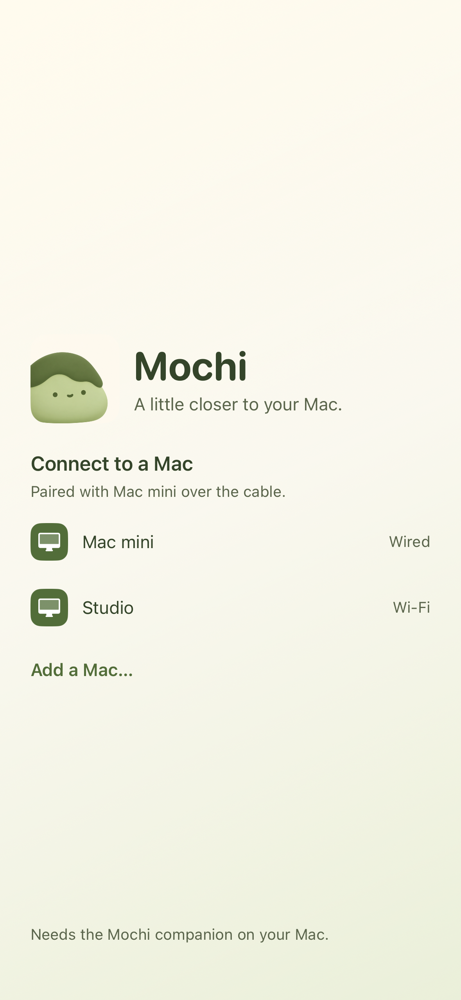
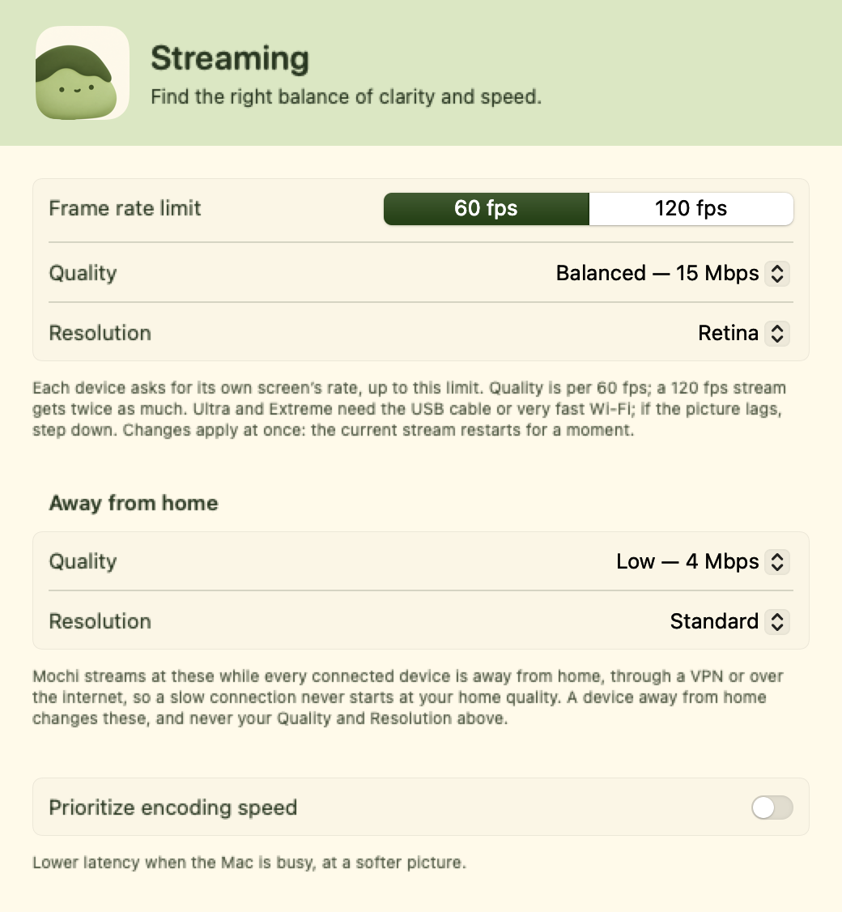

# Mochi

<p align="center">
  
</p>

<p align="center"><strong>Native Swift · Mac + iPhone + iPad · Matcha and cream</strong></p>

Mochi streams a Mac window or desktop to your iPhone or iPad and lets you control it with touch, a trackpad, and a keyboard. It pairs a native Swift app with a matcha-and-cream interface and a friendly dumpling character.

The iPhone layout gives the streamed app most of the screen. Open controls when you need them, switch between Mac apps, or zoom in to read text.

Mochi is a development project. Build and install it from source; this repository does not provide an App Store app, a notarized Mac download, or a hosted remote-access service.

[Set up Mochi](#set-up-mochi) · [Choose a connection](#choose-a-connection) · [Use the iPhone controls](#use-the-iphone-controls) · [Troubleshoot](docs/TROUBLESHOOTING.md)

## A closer look

These are native app previews rendered with demo data. They show the connection screen and Mac controls, without live desktop content or personal device details.

<table>
  <tr>
    <th align="left">Find your Mac</th>
    <th align="left">Make yourself comfortable</th>
  </tr>
  <tr>
    <td width="38%" valign="top">
      
      <p>Choose a Mac and connect. The same character welcomes you inside the app.</p>
    </td>
    <td width="62%" valign="top">
      
      <p>Adjust streaming quality and resolution from the Mac companion.</p>
    </td>
  </tr>
</table>

## What Mochi does

- Streams one Mac window or a desktop at a time using hardware-accelerated HEVC video when available.
- Supports touch input, an optional trackpad, keyboard input, and Mac menus.
- Switches between apps and their open windows.
- Supports cable, local Wi-Fi, nearby direct wireless, and configured remote connections.
- Pairs trusted devices and uses encrypted transport in the Mac app.
- Uses the Mochi character in app icons, the iPhone connection screen, and Mac settings, pairing, and status views.

Mochi does not stream Mac audio or show multiple independent streams at once. Your Mac must stay awake with Mochi running.

<table>
  <tr>
    <td width="33%"><strong>More room to read</strong><br>One app window, a compact toolbar, and reading zoom.</td>
    <td width="33%"><strong>Controls when you need them</strong><br>Open the keyboard or trackpad without keeping both on screen.</td>
    <td width="33%"><strong>Your Mac, your connection</strong><br>Use a cable, local Wi-Fi, or a configured remote network.</td>
  </tr>
</table>

## Requirements

Use the following hardware and software to build and test Mochi.

| Component | Requirement |
| --- | --- |
| Mac | Apple silicon is the tested configuration. The deployment target is macOS 14 or later. |
| iPhone or iPad | iOS or iPadOS 17 or later, with Developer Mode enabled for a development installation. |
| Xcode | Full Xcode with the iOS SDK. The current project is validated with Xcode 27.1. |
| Signing | An Apple Account added to Xcode and a development team selected for the iOS app. |
| Initial connection | A data-capable USB cable is recommended for the first test. |
| Python | Python 3 with TLS 1.3 support for the protocol and integration checks. Python 3.13 was used for validation. |

The standard build does not require a simulator runtime or third-party application frameworks. The optional foldable-device integration is disabled by default and is not validated here.

## Set up Mochi

### 1. Get the source

Clone the repository and open its directory:

```sh
git clone https://github.com/BlackMagicKau/mochi.git
cd mochi
```

For a private repository, authenticate with a GitHub account that has access before cloning.

### 2. Prepare Xcode

1. Open Xcode and complete its first-launch setup. Install the iOS platform support when prompted.
2. In **Xcode > Settings > Accounts**, add your Apple Account.
3. If command-line builds use the wrong developer directory, select your Xcode installation in **Xcode > Settings > Locations > Command Line Tools**.

Check the selected tools:

```sh
xcodebuild -version
xcode-select -p
```

### 3. Build and install the Mac app

Build the Mac companion:

```sh
Scripts/make-mochi.sh
```

The app is created at `.build/Mochi.app`. The script uses your Apple Development signing identity when exactly one valid identity is available. If there are multiple identities, select one explicitly:

```sh
MOCHI_SIGN_IDENTITY="Apple Development: YOUR_CERTIFICATE_NAME" \
  Scripts/make-mochi.sh
```

If no Apple Development identity is available, the script uses ad-hoc signing and prints a warning. A new ad-hoc build can invalidate previous privacy approvals. Use the same development identity for subsequent builds to keep the app's identity stable.

To install the app:

1. Quit any running copy of Mochi.
2. Open the build directory:

   ```sh
   open .build
   ```

3. Move or copy **Mochi.app** to **Applications**. Replace an older installed copy when updating.
4. Open **Mochi** from **Applications**. Mochi runs in the menu bar.

Keep using this installed copy when granting permissions. Launching an older build from another folder can make permission problems harder to diagnose.

### 4. Grant Mac permissions

In **System Settings > Privacy & Security**, grant the permissions that Mochi needs:

| Permission | Purpose |
| --- | --- |
| Screen & System Audio Recording | Lets Mochi capture Mac windows. The current app does not stream audio. |
| Accessibility | Lets taps, keyboard input, and trackpad gestures control your Mac. |
| Local Network, if prompted | Lets your devices discover and connect to each other. |

Select `/Applications/Mochi.app` when adding an app to a permission list. After enabling Screen Recording, choose **Quit & Reopen** if macOS prompts you. Accessibility normally takes effect without a restart.

If a permission is enabled but Mochi still requests it, follow the [permission troubleshooting procedure](docs/TROUBLESHOOTING.md#mochi-keeps-requesting-a-permission).

### 5. Build and install the iPhone or iPad app

1. Connect the device to your Mac with a data-capable cable and unlock it.
2. Accept **Trust This Computer** on the device if prompted.
3. Open the project:

   ```sh
   open iOSClient/Mochi.xcodeproj
   ```

4. Select the **Mochi** project, then the **Mochi** target. In **Signing & Capabilities**, leave **Automatically manage signing** enabled and select your team.
5. If Xcode cannot register `dev.mochi.ios` for your team, change the bundle identifier to a unique identifier that you control.
6. Select the **Mochi** scheme and your physical device as the run destination.
7. On the device, enable **Settings > Privacy & Security > Developer Mode**. Restart and confirm if prompted.
8. In Xcode, select **Product > Run**.
9. If iOS blocks the development app, open **Settings > General > VPN & Device Management**, select your developer entry, and trust it.
10. Open Mochi and allow **Local Network** access when prompted. Allow camera access if you use QR-code pairing.

Development provisioning profiles expire. If the app stops opening after its profile expires, rebuild and reinstall it from Xcode. This is separate from network connectivity.

For command-line signing without committing your team settings, copy `iOSClient/LocalSigning.xcconfig.example` to `iOSClient/LocalSigning.xcconfig` and replace `YOUR_TEAM_ID`. Git ignores the local file. Selecting a team directly in Xcode can modify the project file; do not commit another developer's personal signing settings.

## Choose a connection

The connection must provide a network route between both devices. Installing the app alone does not create an internet relay.

| Connection | When to use it | Setup |
| --- | --- | --- |
| Cable | First-time testing or use beside your Mac | Connect and unlock the device, then select the Mac discovered by Mochi. A recognized cable connection is labeled as wired. |
| Same Wi-Fi | Use on a shared local network | Put both devices on the same network, open both apps, and select the discovered Mac. Guest networks can block device-to-device traffic. |
| Direct wireless | Use nearby without a shared Wi-Fi network | Enable **Direct Wireless Connection** in the Mac app and use **Search Nearby** on the device. Keep Wi-Fi available on both devices. |
| Remote network or VPN | Use from a different location | Configure a permitted network route to the Mac, then use **Add Mac** with its reachable address or pairing link. Both devices must have access to that route. |

For the first connection:

1. Leave the Mac awake with Mochi running.
2. Open Mochi on your iPhone or iPad and select the discovered Mac.
3. Follow the pairing instructions shown by the apps. If Mochi recognizes a trusted cable, pairing can complete over the cable; otherwise, use the code or QR flow.
4. Select a Mac app or window to start streaming.

A phone on cellular cannot reach a private Mac address without an appropriate remote network path. A corporate VPN on the Mac alone does not provide that path to the phone. Follow your organization's policies for remote access on a managed Mac.

## Use the iPhone controls

The iPhone toolbar exposes controls without keeping a large trackpad on screen.

| Control | Action |
| --- | --- |
| **Apps** | Open the app switcher. Select an app; select an already open app again to cycle through its windows. |
| **Keyboard** | Show typing controls and shortcut keys. |
| **Trackpad** | Show or hide a trackpad for pointer control. |
| **Zoom** | Enter reading mode. Pinch to zoom and drag to move around the picture. |
| **Control** | Return from reading mode to interacting with the Mac while retaining the zoom level. |
| **Fit** | Reset the reading view to show the entire picture. |
| **More** | Open desktop selection, Mac menus, text size, settings, and help. |

For readable text, start with one app window. Mochi requests a window size that fits the phone, but some Mac apps enforce a minimum width. Use landscape orientation or **Zoom** when you need more room. Zooming magnifies the received image; it does not change the Mac app's font size.

The iPad retains its separate layout. The phone layout is not a full desktop compressed into a permanently small preview.

## Update an existing installation

1. Get the latest source:

   ```sh
   git pull --ff-only
   ```

2. Build the Mac update with the same signing identity:

   ```sh
   Scripts/make-mochi.sh --staged
   ```

3. Quit Mochi and replace `/Applications/Mochi.app` with `.build/Mochi-next.app`, naming the installed copy `Mochi.app`.
4. Rebuild and run the iOS app from Xcode.
5. Open both apps and reconnect.

Keep the Mac and iOS versions together. Mochi uses its own pairing and transport identifiers and is intended to connect to another Mochi app.

## Develop and verify

The main source areas are:

| Path | Contents |
| --- | --- |
| `Sources/MochiHost` | Capture, encoding, transport, pairing, and remote input. |
| `Sources/MochiMenuBar` | Mac app lifecycle, settings, status, and permissions. |
| `Sources/StreamProtocol` | Shared wire format and connection policies. |
| `iOSClient` | iPhone and iPad app, display, controls, and pairing. |
| `design/MochiCharacter.png` | Selected A1 character used in the product. |
| `Tests/checks` | Regression checks that compile the relevant Swift sources. |

Run syntax, property-list, and regression checks:

```sh
Scripts/check-mochi.sh
```

Run selected checks during development:

```sh
Scripts/check-mochi.sh phone-portrait protocol cable-link
```

The network checks use loopback connections. A sandbox that blocks local sockets can cause failures or timeouts.

To verify synthetic pairing and video transport:

```sh
swift build -c release --product MochiHost
python3.13 Scripts/smoke-mochi.py
```

This test uses temporary identities and generated pixels. It does not capture your desktop or inject input. It verifies pairing and encoded video delivery, not physical-device usability.

To compile the iOS app without signing or a simulator runtime:

```sh
xcodebuild -project iOSClient/Mochi.xcodeproj -scheme Mochi \
  -destination 'generic/platform=iOS' -configuration Debug \
  -derivedDataPath .build/iOS CODE_SIGNING_ALLOWED=NO build
```

An unsigned build cannot be installed on a physical device. See the [validation notes](docs/MOCHI-CHANGES.md) for tested configurations and limits.

## Known limits

- The Mac must remain awake. Mochi does not wake a powered-off Mac or provide access before macOS login. Closing a MacBook lid can put it to sleep.
- Remote access requires your own reachable network configuration. There is no Mochi cloud relay.
- Mac audio and simultaneous independent window streams are not implemented.
- Some Mac apps cannot shrink to a phone-sized window.
- The optional virtual-display implementation uses private CoreGraphics APIs.
- Mac distribution is not notarized, and the project has no configured App Store release or automatic update service.
- Optional foldable-device support is disabled unless built with `MOCHI_FOLDABLE_SDK` and a supporting SDK.

## Meet Mochi

<table>
  <tr>
    <td width="160"></td>
    <td><strong>A small companion for your Mac.</strong><br>The selected A1 character appears in the app icon, connection screen, and Mac settings, pairing, and status views. The interface uses cream surfaces, matcha accents, and dark tea-green text.<br><br><a href="design/README.md">Explore the design assets</a></td>
  </tr>
</table>

## Get help

Use the [troubleshooting guide](docs/TROUBLESHOOTING.md) for setup and connection problems. For a reproducible bug, [open an issue](https://github.com/BlackMagicKau/mochi/issues) with the device models, OS versions, build revision, and reproduction steps. Remove pairing codes, tokens, addresses, and private window content from attachments.

For security-sensitive reports, follow the [security policy](SECURITY.md).

## License

Mochi is distributed under [Apache-2.0](LICENSE). The [NOTICE](NOTICE) file records the original project's attribution and Mochi's modifications. Both files are included in the app bundles.
